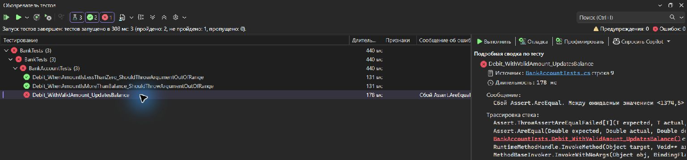
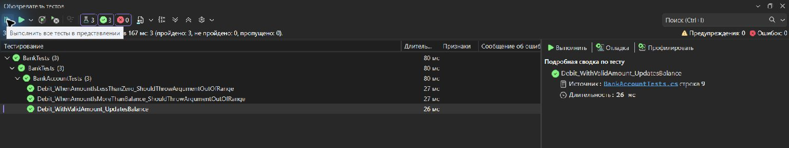

# Практическая работа № 1. Модульное тестирование в Visual Studio
Кузнецов Андрей Андреевич, ИПс-21. Пермь, 2026.

# ВВЕДЕНИЕ

Практическая работа посвящена созданию и запуску модульных тестов для программы на языке C#. В качестве объекта проверки используется учебный класс BankAccount. Он хранит данные банковского счёта и предоставляет операции пополнения и списания средств.

Цель работы - освоить подготовку тестового проекта MSTest, проверку результатов в Обозревателе тестов Visual Studio и поиск ошибки по расхождению ожидаемого и фактического значений. Отдельно рассматривается проверка исключений при недопустимых аргументах.

Последовательность действий соответствует разделу «Пошаговое руководство. Создание и запуск модульных тестов для управляемого кода» руководства «Средства тестирования Visual Studio 2022», страницы 158-170. Для выполнения используется установленная Visual Studio Community 2026, а целевой платформой проектов остаётся .NET 8.

В работе сохранены имена классов и методов из руководства. Для примеров выбраны собственные данные клиента и суммы: начальный баланс 1800,00 и списание 425,50. При корректной работе остаток должен составить 1374,50.

# 1 Постановка задачи

Необходимо создать решение из тестируемого консольного проекта Bank и проекта BankTests. В первом размещается BankAccount, во втором - автоматические проверки метода Debit. После обнаружения учебной ошибки её требуется исправить и повторить запуск тестов.

Таблица 1 - Условия проверки метода Debit

| Условие | Ожидаемое поведение |
| 0 ≤ amount ≤ Balance | Сумма вычитается из баланса счёта. |
| amount < 0 | ArgumentOutOfRangeException: сумма списания отрицательна. |
| amount > Balance | ArgumentOutOfRangeException: сумма превышает остаток. |

## 1.1 Программные средства

Работа выполнена в Windows с Visual Studio Community 2026 версии 18.4.2. Установлен .NET SDK 10.0.201; проекты компилируются для net8.0 и запускаются установленной средой выполнения .NET 8. Для модульных тестов используются MSTest.TestFramework и MSTest.TestAdapter 4.0.2, Microsoft.NET.Test.Sdk 17.14.1.

Тестовые данные являются учебными. Класс воспроизводит пример из руководства и использует double с допуском сравнения 0,001. Работа не предназначена для обработки реальных банковских операций.

# 2 Ход выполнения работы

## 2.1 Создание тестируемого проекта

В Visual Studio выбирается «Создать проект» и шаблон консольного приложения C#. Для проекта задаётся имя Bank, для решения - KuznetsovBank, для платформы - .NET 8. Файл с исходным кодом переименовывается в BankAccount.cs. Пространство имён BankAccountNS сохраняется по руководству.

В BankAccount объявляются поля m_customerName и m_balance. Конструктор получает имя клиента и начальный остаток. Свойства CustomerName и Balance позволяют читать данные счёта. Метод Credit увеличивает остаток, а Debit должен уменьшать его после проверки аргумента.

## 2.2 Подключение проекта модульных тестов

Через контекстное меню решения выбирается «Добавить» - «Создать проект» и шаблон MSTest. Новый проект называется BankTests. В разделе «Зависимости» добавляется ссылка на Bank. Благодаря ProjectReference тесты используют непосредственно класс из тестируемой программы.

```csharp
KuznetsovBank.sln
  Bank/Bank.csproj
    BankAccount.cs
  BankTests/BankTests.csproj
    BankAccountTests.cs
    MSTestSettings.cs
```

## 2.3 Подготовка тестового класса

В файле BankAccountTests.cs подключаются BankAccountNS и Microsoft.VisualStudio.TestTools.UnitTesting. Класс BankAccountTests получает атрибут [TestClass]. Для каждого метода, который должен обнаружить Обозреватель тестов, ставится [TestMethod]. Тесты возвращают void и не принимают аргументов.

## 2.4 Проверка допустимой суммы

Первый тест строится по схеме Arrange-Act-Assert. Подготовка создаёт счёт с остатком 1800,00, сумму списания 425,50 и ожидаемый результат 1374,50. Затем вызывается Debit, после чего Assert.AreEqual сравнивает фактический остаток с ожидаемым.

```csharp
double beginningBalance = 1800.00;
    double debitAmount = 425.50;
    double expected = 1374.50;
    BankAccount account = new("Andrey Kuznetsov", beginningBalance);
    account.Debit(debitAmount);
    Assert.AreEqual(expected, account.Balance, 0.001,
        "Account not debited correctly");
```

## 2.5 Сборка и первый запуск

Для сборки используется команда «Сборка» - «Построить решение». Затем через меню «Тест» открывается «Обозреватель тестов» и выполняется запуск. В учебной версии Debit оставляется намеренная ошибка: m_balance += amount вместо вычитания суммы.

Тест допустимой суммы обнаруживает расхождение: ожидается 1374,50, фактически получается 2225,50. Это соответствует вычислению 1800,00 + 425,50. Проверки недопустимых сумм при этом проходят, поскольку исключения выбрасываются до изменения баланса. Контрольный запуск в Visual Studio показан на рисунке 1.



Сообщение Assert.AreEqual указывает, что ошибка связана с конечным остатком, а не с обнаружением теста или его настройкой. Сохранённый протокол первого запуска находится в docs/evidence/bank-initial-failure.txt.

## 2.6 Исправление кода и повторная проверка

В BankAccount.cs строка изменения баланса заменяется на m_balance -= amount. Условия проверки аргумента сохраняются. После сохранения исходного файла решение собирается повторно и запускаются тесты. Остаток 1374,50 теперь совпадает с ожидаемым значением.

```csharp
// Было в учебной версии:
    m_balance += amount;
    // Окончательная версия:
    m_balance -= amount;
```

## 2.7 Дополнительные тесты

Для отрицательной суммы создаётся Debit_WhenAmountIsLessThanZero_ShouldThrowArgumentOutOfRange. В нём используется счёт с балансом 1800,00 и аргумент -25,00. Для превышения остатка создаётся Debit_WhenAmountIsMoreThanBalance_ShouldThrowArgumentOutOfRange с аргументом 2000,00 при том же начальном балансе.

Оба сценария должны завершать вызов Debit исключением ArgumentOutOfRangeException. Списание при таких входных данных не выполняется. Сами тестовые методы считаются пройденными только после подтверждения ожидаемого исключения.

## 2.8 Уточнение сообщений исключений

Одного типа исключения недостаточно, чтобы различить причины отказа. Поэтому в BankAccount вводятся две строковые константы: DebitAmountExceedsBalanceMessage и DebitAmountLessThanZeroMessage. Исключение получает имя аргумента, его значение и сообщение, соответствующее нарушенному условию.

```csharp
if (amount > m_balance)
        throw new ArgumentOutOfRangeException(nameof(amount), amount,
            DebitAmountExceedsBalanceMessage);
    if (amount < 0)
        throw new ArgumentOutOfRangeException(nameof(amount), amount,
            DebitAmountLessThanZeroMessage);
```

## 2.9 Рефакторинг тестовых методов

Для проверки сообщения используется try/catch и StringAssert.Contains. Если ожидаемое исключение перехвачено и содержит нужный текст, выполняется return. Если Debit не создал исключение, управление дойдёт до Assert.Fail и тест завершится ошибкой. Это исключает ложное успешное прохождение.

## 2.10 Окончательная версия тестов

Итоговый набор содержит три теста. Каждый создаёт собственный объект BankAccount, поэтому состояние одного счёта не влияет на другой тест. В MSTestSettings.cs явно разрешено параллельное выполнение на уровне методов.

Таблица 2 - Результаты модульного тестирования

| Проверка | Данные | Итог |
| Допустимая сумма | 1800,00 − 425,50 = 1374,50 | Пройден |
| Отрицательная сумма | Списание -25,00 | Пройден |
| Превышение баланса | Списание 2000,00 при остатке 1800,00 | Пройден |



## 2.11 Запуск из командной строки

Для независимого повторения проверки в папке решения выполняются команды ниже. При первом запуске нужен доступ к NuGet для восстановления пакетов. Сборка проведена также непосредственно в Visual Studio; её протокол сохранён в docs/evidence/visual-studio-build.txt.

```csharp
dotnet restore KuznetsovBank.sln
dotnet build KuznetsovBank.sln -c Release
dotnet test KuznetsovBank.sln -c Release
dotnet run --project Bank -c Release
```

## 2.12 Результаты проверки

Окончательная сборка выполнена без ошибок и предупреждений. Все три теста пройдены, пропущенных тестов нет. Консольный пример начинает с 1800,00, добавляет 250,00 и списывает 425,50; полученный остаток составляет 1624,50. Вывод программы сохранён в bank-console.txt.

# 3 Размещение проекта на GitHub

В корне подготовленного комплекта находятся KuznetsovBank.sln, Directory.Build.props и папки Bank, BankTests, docs. В docs размещены эта записка, исходный текст отчёта, иллюстрации и протоколы проверки. README содержит сведения об авторе и команды сборки и запуска.

Перед публикацией из набора исключаются bin, obj, .vs, TestResults и пользовательские файлы Visual Studio. Эти правила записаны в .gitignore. Исходные файлы загружаются в репозиторий вместе с PDF; после загрузки следует проверить открытие решения и документа по публичной ссылке.

Для этой работы создан отдельный репозиторий Kuznetsov-BankUnit-Testing. В него включены исходники, записка и результаты проверки. В комплект не включаются исполняемые файлы и восстановленные пакеты NuGet. Адрес репозитория:

https://github.com/waw9991/Kuznetsov-BankUnit-Testing

# ЗАКЛЮЧЕНИЕ

В результате работы подготовлено решение KuznetsovBank с учебным банковским счётом и проектом модульных тестов. На примере неверного знака операции показано, как тест обнаруживает ошибку, а повторный запуск подтверждает её исправление.

Освоены атрибуты TestClass и TestMethod, схема Arrange-Act-Assert, сравнение чисел с допуском и проверка исключений. Использование StringAssert.Contains, return и Assert.Fail позволило различать причины отказа и избежать ложного успешного результата.

Три обязательных сценария из руководства проверены в Visual Studio и из командной строки. Итоговая версия исходных файлов соответствует приведённым в приложениях листингам, а иллюстрации получены при запуске подготовленного решения.

# СПИСОК ИСПОЛЬЗОВАННЫХ ИСТОЧНИКОВ

1. Средства тестирования Visual Studio 2022. Раздел «Пошаговое руководство. Создание и запуск модульных тестов для управляемого кода». С. 158-170. Локальная PDF-копия руководства.

2. Microsoft Learn. Создание и запуск модульных тестов для управляемого кода. URL: https://learn.microsoft.com/ru-ru/visualstudio/test/walkthrough-creating-and-running-unit-tests-for-managed-code?view=vs-2022

3. Microsoft Learn. Основные сведения о модульных тестах. URL: https://learn.microsoft.com/ru-ru/visualstudio/test/unit-test-basics?view=vs-2022

4. Microsoft. MSTest, исходный код и документация. URL: https://github.com/microsoft/testfx

# ПРИЛОЖЕНИЕ А Код класса BankAccount

```csharp
namespace BankAccountNS;

/// <summary>Учебная модель банковского счёта.</summary>
public class BankAccount
{
    public const string DebitAmountExceedsBalanceMessage = "Debit amount exceeds balance";
    public const string DebitAmountLessThanZeroMessage = "Debit amount is less than zero";

    private readonly string m_customerName = string.Empty;
    private double m_balance;

    private BankAccount() { }

    public BankAccount(string customerName, double balance)
    {
        m_customerName = customerName;
        m_balance = balance;
    }

    public string CustomerName => m_customerName;
    public double Balance => m_balance;

    public void Debit(double amount)
    {
        if (amount > m_balance)
            throw new ArgumentOutOfRangeException(nameof(amount), amount,
                DebitAmountExceedsBalanceMessage);
        if (amount < 0)
            throw new ArgumentOutOfRangeException(nameof(amount), amount,
                DebitAmountLessThanZeroMessage);

        m_balance -= amount;
    }

    public void Credit(double amount)
    {
        if (amount < 0)
            throw new ArgumentOutOfRangeException(nameof(amount));
        m_balance += amount;
    }

    public static void Main()
    {
        BankAccount account = new("Andrey Kuznetsov", 1800.00);
        account.Credit(250.00);
        account.Debit(425.50);
        Console.WriteLine($"Customer: {account.CustomerName}");
        Console.WriteLine($"Current balance: {account.Balance:F2}");
    }
}
```

# ПРИЛОЖЕНИЕ Б Код модульных тестов

```csharp
using BankAccountNS;
using Microsoft.VisualStudio.TestTools.UnitTesting;

namespace BankTests;

[TestClass]
public class BankAccountTests
{
    [TestMethod]
    public void Debit_WithValidAmount_UpdatesBalance()
    {
        // Arrange: подготовка счёта и ожидаемого остатка.
        double beginningBalance = 1800.00;
        double debitAmount = 425.50;
        double expected = 1374.50;
        BankAccount account = new("Andrey Kuznetsov", beginningBalance);

        // Act: выполнение списания.
        account.Debit(debitAmount);

        // Assert: сравнение фактического и ожидаемого баланса.
        Assert.AreEqual(expected, account.Balance, 0.001,
            "Account not debited correctly");
    }

    [TestMethod]
    public void Debit_WhenAmountIsLessThanZero_ShouldThrowArgumentOutOfRange()
    {
        BankAccount account = new("Andrey Kuznetsov", 1800.00);
        double debitAmount = -25.00;

        try
        {
            account.Debit(debitAmount);
        }
        catch (ArgumentOutOfRangeException exception)
        {
            StringAssert.Contains(exception.Message,
                BankAccount.DebitAmountLessThanZeroMessage);
            return;
        }

        Assert.Fail("The expected exception was not thrown.");
    }

    [TestMethod]
    public void Debit_WhenAmountIsMoreThanBalance_ShouldThrowArgumentOutOfRange()
    {
        BankAccount account = new("Andrey Kuznetsov", 1800.00);
        double debitAmount = 2000.00;

        try
        {
            account.Debit(debitAmount);
        }
        catch (ArgumentOutOfRangeException exception)
        {
            StringAssert.Contains(exception.Message,
                BankAccount.DebitAmountExceedsBalanceMessage);
            return;
        }

        Assert.Fail("The expected exception was not thrown.");
    }
}
```
